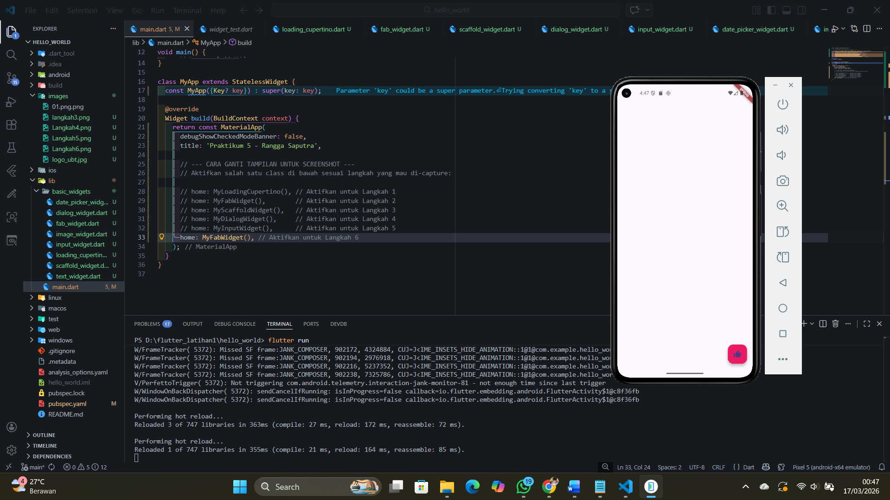
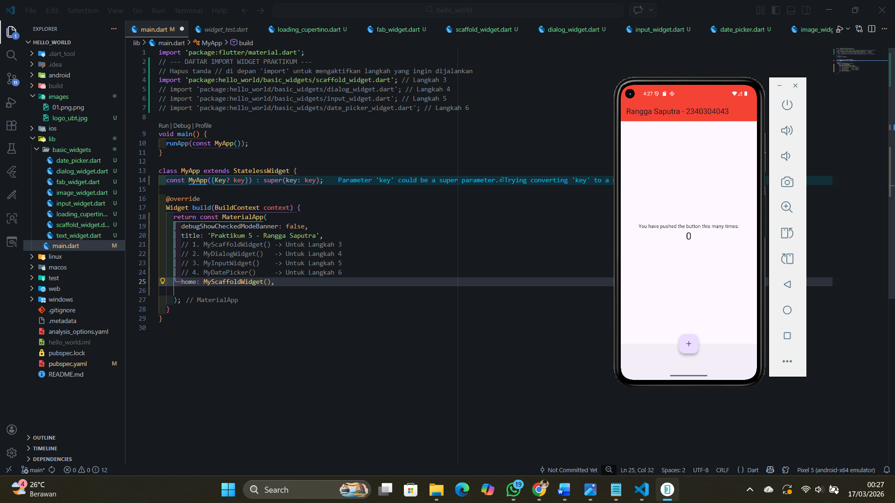
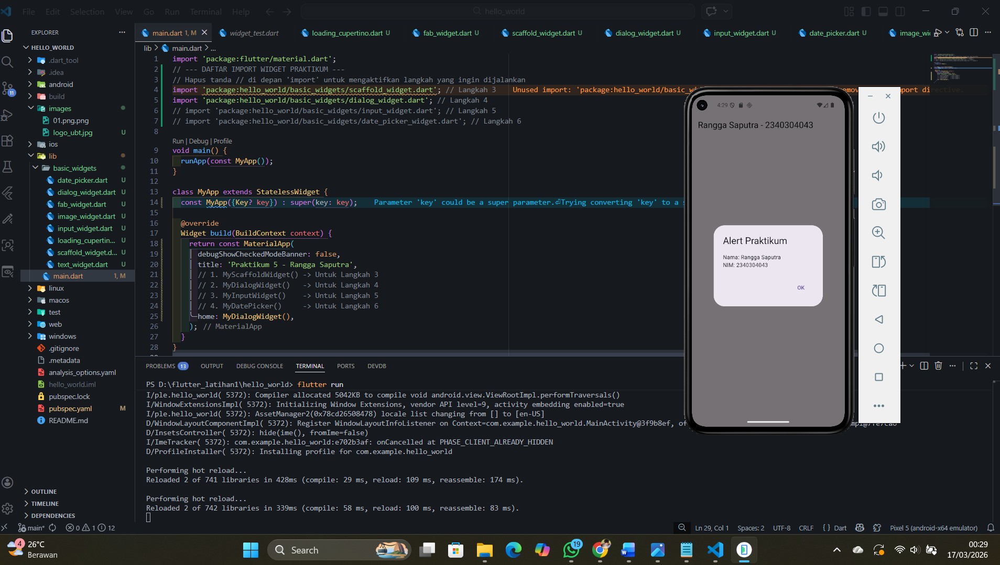
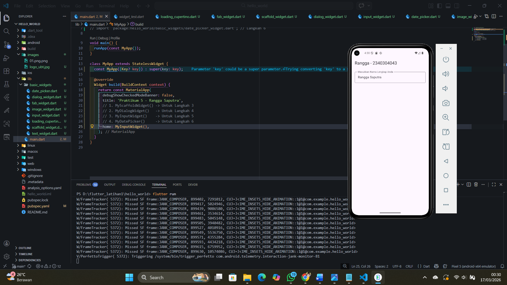
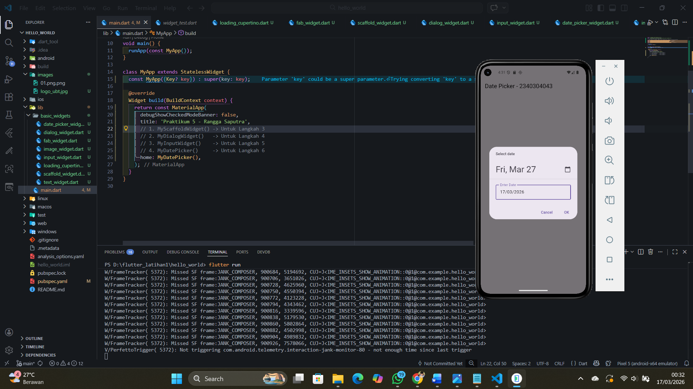

# Project Tugas Kuliah hello_world

A new Flutter project.

# Laporan Praktikum Pemrograman Mobile

## Praktikum: Widget Material Design & Cupertino

### Langkah 1: Cupertino Button dan Loading Bar
**Penjelasan:** Mengimplementasikan widget bergaya iOS menggunakan library Cupertino. Menampilkan tombol (CupertinoButton) dan indikator pemuatan (CupertinoActivityIndicator) yang memiliki tampilan khas perangkat Apple.

### Langkah 2: Floating Action Button (FAB)
**Penjelasan:** Menambahkan tombol melayang (FloatingActionButton) pada Scaffold. Tombol ini ditempatkan di atas konten aplikasi dan biasanya digunakan untuk aksi utama, dalam hal ini menggunakan ikon jempol dengan warna merah muda.

### Langkah 3: Scaffold Widget
**Penjelasan:** Menggunakan Scaffold sebagai struktur dasar halaman Material Design yang mencakup AppBar (Header), Body (Konten Utama), BottomNavigationBar (Footer), dan FloatingActionButton. Dilengkapi dengan logika Counter untuk menambah angka saat tombol ditekan.

### Langkah 4: Dialog Widget
**Penjelasan:** Mengimplementasikan fungsi `showDialog` untuk memunculkan modal AlertDialog. Dialog ini berfungsi untuk memberikan informasi atau konfirmasi kepada pengguna dengan tombol "OK" untuk menutup kembali jendela tersebut.

### Langkah 5: Input dan Selection Widget (TextField)
**Penjelasan:** Menggunakan widget `TextField` untuk menerima input teks. Dilengkapi dengan `InputDecoration` untuk menampilkan label "Nama" serta `OutlineInputBorder` agar kotak input memiliki garis tepi yang jelas.

### Langkah 6: Date and Time Pickers
**Penjelasan:** Mengimplementasikan fitur pemilihan tanggal menggunakan fungsi `showDatePicker`. Widget ini bersifat asynchronous yang akan menunggu pengguna memilih tanggal pada kalender pop-up, kemudian memperbarui tampilan teks dengan tanggal yang dipilih.

